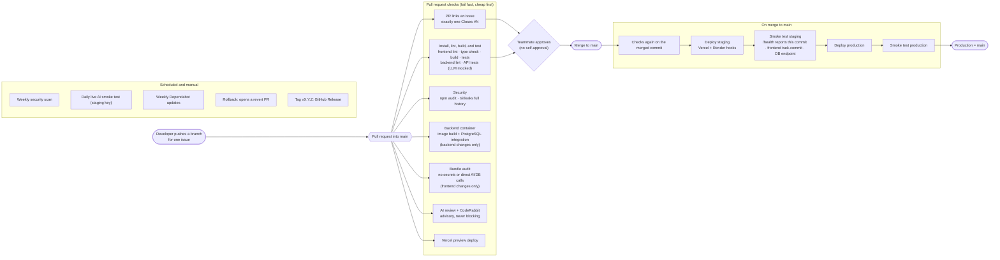

# TSEK pipeline

How a change gets from a developer's commit to production, and why each
stage exists. Everything runs on GitHub Actions. Hosting: Vercel (frontend),
Render (backend), Neon (PostgreSQL).

Related: [deploy and rollback runbook](docs/RUNBOOK.md) ·
[environments](docs/STAGING.md) · [CI/CD setup](docs/CI_CD.md) ·
[metrics log](docs/PIPELINE_METRICS.MD) ·
[optimization log](docs/OPTIMIZATION_LOG.MD) ·
[incident log](docs/INCIDENTS.MD)

**Status key:** **Live** = on `main` today. **PR #N** = written and waiting
for review in that pull request; it is listed so the plan is visible, but it
is not running yet.

## Diagram

## Pull request stages

They run in parallel when a pull request into `main` is opened or updated.
Inside the main check job, cheap steps run before expensive ones, so a lint
error fails in seconds before the build and tests run. Superseded runs on the
same pull request are cancelled.

| # | Stage | Workflow / job | Why it exists | Trigger | Blocks merge? | Status |
|---|---|---|---|---|---|---|
| 1 | Issue link | `pr-issue-link.yml` / **PR links an issue** | Every change traces to exactly one issue (1 issue = 1 PR), which keeps PRs small and the board accurate | PR opened, edited, updated | Yes (required) | Live; "exactly one" in PR #82 |
| 2 | Component check | `ci.yml` / Install, lint, build, and test | Fails if `frontend/` or `backend/` lockfile is missing instead of silently skipping their checks | PR, push to `main` | Yes (required) | PR #81 |
| 3 | Install | same job | Clean, reproducible install from each `package-lock.json` (`npm ci`) | same | Yes | Live |
| 4 | Lint | same job | Cheapest check; catches mistakes before anything is built | same | Yes | Live (backend made mandatory in PR #81) |
| 5 | Type check + build | same job (`npm run build` runs `tsc --noEmit` then Vite) | The frontend must compile and type-check to be deployable | same | Yes | Live |
| 6 | Frontend unit tests | same job | Checklist logic and the services API helper keep working | same | Yes | PR #83 |
| 7 | Backend API tests (LLM mocked) | same job (`npm test --prefix backend`) | CRUD, validation, error handling and AI-provider failures tested without paid or flaky live AI calls | same | Yes | Live; mandatory (no `--if-present`) in PR #81 |
| 8 | Dependency audit | `security.yml` / Dependency audit (frontend, backend) | No shipped dependency with a high or critical advisory | PR, push to `main`, Mondays | After it is made required | PR #84 |
| 9 | Secret scan | `security.yml` / Secret scan (full history) | Proves no key or password exists anywhere in the Git history | PR, push to `main`, Mondays | After it is made required | PR #84 |
| 10 | Container + integration test | `container.yml` / Build image and test against PostgreSQL | Builds the backend image (layer-cached) and checks migrations, seed and the API against a real PostgreSQL | PR or push touching `backend/**` (path filter) | No (path-filtered) | PR #91 |
| 11 | Bundle audit | `bundle-audit.yml` / Frontend bundle audit | The built frontend must not contain secrets or call OpenAI or the database directly (core requirement 3) | PR or push touching `frontend/**` | No (path-filtered) | Live |
| 12 | AI review | `ai-review.yml` / TSEK AI review, plus CodeRabbit | Automated reviewer on every PR (mentor requirement); secrets are redacted before the diff is sent | PR opened, updated, ready for review | No: advisory, and a provider outage never blocks work | Live |
| 13 | Preview deploy | Vercel Git integration | A live preview URL for each PR, so reviewers can check behavior | PR | No | Live |
| 14 | Peer review | Branch protection on `main` | A teammate approves; authors cannot approve their own latest push; admins cannot bypass | PR | Yes | Live |

## Merge to `main`: continuous deployment

`ci.yml` runs again on the merged commit, then calls `deploy.yml` once per
environment. Production runs only if staging passed.

| # | Stage | Why it exists | Fails when | Status |
|---|---|---|---|---|
| 15 | Checks on the merged commit | The merge result, not just the branch, must pass | Any check fails | Live |
| 16 | Deploy staging | Every merge deploys automatically, first to a safe environment (Neon `staging` branch, staging key with a spending limit) | A deploy hook fails, or a hook secret is missing | Live; "missing is a failure" in PR #67 |
| 17 | Smoke test staging | Proves staging serves **this** commit: backend `/health` reports it, the frontend's `tsek-commit` meta tag matches, and the database-backed endpoint answers | Wrong or old commit after the time limit, DB endpoint fails, or a URL variable is missing | Live; needs `/health` commit (PR #58) and hosting configured (#13) |
| 18 | Deploy production | Only a release that passed in staging reaches users | Same as 16 | Live |
| 19 | Smoke test production | Health check after release; the run summary is the team notification | Same as 17 | Live |

If `main` moves on while a deploy is waiting, the older run skips deploying,
because deploy hooks always build the newest commit. The newer run deploys and
tests that commit instead.

## Scheduled, manual and tag-triggered

| Stage | Workflow | Why it exists | Trigger | Status |
|---|---|---|---|---|
| Weekly security scan | `security.yml` | New advisories appear without code changes | Mondays 09:17 PHT | PR #84 |
| Live AI smoke test | `ai-smoke.yml` | The only live AI call: one synthetic request a day to staging, checking the answer's shape. Kept out of the deploy path so an AI outage never blocks a deploy | Daily 08:43 PHT, manual | PR #90 |
| Dependency updates | `dependabot.yml` | Keeps npm packages and Actions current through normal PRs | Mondays | PR #86 |
| Rollback | `rollback.yml` | Opens a reviewed revert PR for a bad commit, so `main` matches production after an emergency host rollback | Manual | PR #88 |
| Release | `release.yml` | Publishes a GitHub Release from `CHANGELOG.md`, only for a tag on `main` whose pipeline passed | Push of a `vX.Y.Z` tag | PR #89 |

## AI-aware practices

- **Cost:** the provider is mocked in every CI test. The only live calls are
  the daily smoke test and real user traffic.
- **Non-determinism:** tests and the smoke test check the shape and validity
  of AI output, never exact wording.
- **Outages:** AI review is advisory and the AI smoke test is a separate
  workflow, so a provider outage cannot block merging or deploying.
- **Keys:** separate OpenAI keys per environment, with a spending limit on
  staging. The bundle audit fails if a key or a direct OpenAI call reaches the
  frontend.
- **Prompts are code:** planned under #31/#32. When prompt or schema files
  change, the evaluation set runs and reports whether quality held.

## Secrets

All secrets live in host dashboards and GitHub environment secrets, scoped per
environment. None are in the repository or its history (checked by the secret
scan). The variable names and where each one lives are listed in
[`.env.example`](.env.example).

## Measuring the pipeline

Durations, success rate, deploys, lead time and time to recover are recorded
every sprint in [`docs/PIPELINE_METRICS.MD`](docs/PIPELINE_METRICS.MD), from the
GitHub Actions API. Each optimization is applied one at a time with before and
after numbers in [`docs/OPTIMIZATION_LOG.MD`](docs/OPTIMIZATION_LOG.MD) (#37).
