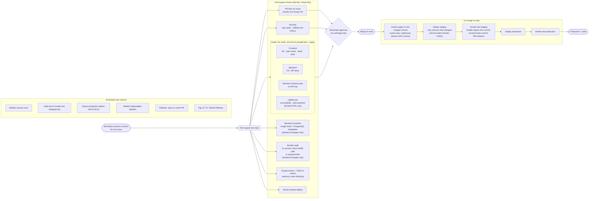

# TSEK pipeline

How a change gets from a developer's commit to production, and why each
stage exists. CI and deployment workflows run on GitHub Actions; Vercel
builds pull request previews through its own Git integration. Hosting: Vercel
(frontend), Render (backend), Neon (PostgreSQL).

Related: [deploy and rollback runbook](docs/RUNBOOK.md) ·
[environments](docs/STAGING.md) · [CI/CD setup](docs/CI_CD.md) ·
[metrics log](docs/PIPELINE_METRICS.MD) ·
[optimization log](docs/OPTIMIZATION_LOG.MD) ·
[incident log](docs/INCIDENTS.MD)

**Status key:** **Live** = on `main` today. **PR #N** = written and waiting
for review in that pull request; it is listed so the plan is visible, but it
is not running yet.

## Diagram

## Pull request stages

They run in parallel when a pull request into `main` is opened or updated.
Inside the main check job, cheap steps run before expensive ones, so a lint
error fails in seconds before the build and tests run. Superseded runs on the
same pull request are cancelled.

| # | Stage | Workflow / job | Why it exists | Trigger | Blocks merge? | Status |
|---|---|---|---|---|---|---|
| 1 | Issue link | `pr-issue-link.yml` / **PR links an issue** | Every change traces to exactly one issue (1 issue = 1 PR), which keeps PRs small and the board accurate | PR opened, edited, updated | Yes (required) | Live; "exactly one" since PR #82 |
| 2 | Component check | `ci.yml` ("Pull request checks") / Frontend lint, build, and test; Backend lint and API tests | Each job fails if its app's lockfile is missing instead of silently skipping its checks | PR, and every push to `main` through `deploy-main.yml` | Yes (through the gate, stage 7b) | Live (PR #81); split per job in optimization 5 |
| 3 | Install | each job | Clean, reproducible install from each `package-lock.json` (`npm ci`) | same | Yes | Live |
| 4 | Lint | frontend and backend jobs | Cheapest check; catches mistakes before anything is built | same | Yes | Live (backend made mandatory in PR #81) |
| 5 | Type check + build | frontend job (`npm run build` runs `tsc --noEmit` then Vite) | The frontend must compile and type-check to be deployable | same | Yes | Live |
| 6 | Frontend unit tests | frontend job | Checklist logic and the services API helper keep working. Includes axe-core accessibility tests (WCAG 2.1 A/AA) on the landing page, sign-in and its error, My applications, the new-application modal, the application page, and the staff queue and review screen; any violation fails the job | same | Yes | Live (PR #83); accessibility tests since #239 |
| 7 | Backend API tests | backend job (every `test/*.test.js` except the mocked AI files) | CRUD, validation, auth, quotas and error handling | same | Yes | Live; mandatory since PR #81. Fails if a listed AI test file is missing, so a rename cannot drop a test |
| 7a | Mocked AI failure tests | `ci.yml` / **Mocked AI failure tests** (`AI_TEST_FILES`) | AI success, timeout, provider errors and malformed output tested with no API key, so a provider outage or spending limit cannot fail CI; prompt and schema fingerprints fail on an unversioned change | same | Yes | Live (#156); its own parallel job since optimization 5, run once instead of twice |
| 7a2 | Lighthouse | `ci.yml` / **Lighthouse accessibility and best practices** (`frontend/lighthouserc.json`) | Lighthouse CI on the built landing page and signed-out sign-in route. Fails below 0.90 for accessibility or best practices (worst run); performance below 0.80 is a warning. Catches what jsdom cannot, such as colour contrast. Reports are uploaded as the `lighthouse-report` artifact | PRs that change `frontend/`; other PRs and `main` pass with a notice instead of skipping | Yes (through the gate) | Live (#239) |
| 7b | Gate | `ci.yml` / **Install, lint, build, and test** | Keeps the required check name: passes only if all four jobs passed. Runs even when a job fails (`always()`), so the required check fails rather than showing as skipped | same | Yes (required) | Live since optimization 5 |
| 8 | Dependency audit | `security.yml` / Dependency audit (frontend, backend) | No shipped dependency with a high or critical advisory, except one listed in `.github/audit-exceptions.json` for that app with a reason, issue and expiry date; an expired exception fails again | PR, push to `main`, Mondays | Yes (required) | Live (PR #84); exceptions since #269 (INC-11) |
| 9 | Secret scan | `security.yml` / Secret scan (full history) | Detects known key, password and token patterns in every commit of the Git history | PR, push to `main`, Mondays | Yes (required) | Live (PR #84) |
| 10 | Container + integration test | `container.yml` / Build image and test against PostgreSQL | Builds the backend image (layer-cached) and checks migrations, seed and the API against a real PostgreSQL | PR or push touching `backend/**` (path filter) | No (path-filtered) | Live (PR #91) |
| 11 | Bundle audit | `bundle-audit.yml` / Frontend bundle audit | The built frontend must not contain secrets or call OpenAI or the database directly (core requirement 3), or ship files that should never be public: source maps, dotfiles, env files, keys, backups, dumps, logs, archives, project config (#294) | PR or push touching `frontend/**` | No (path-filtered) | Live |
| 12 | AI review | `claude-review.yml` / **Claude review**, plus `ai-review.yml` / TSEK AI review | An automated reviewer on every PR (mentor requirement): Claude posts inline findings with severity, keeps one summary up to date, re-checks and resolves its own findings, and `@claude fix` fixes them (#134, #137). The TSEK AI review adds automatic secret and boundary checks. CodeRabbit runs only on request (`@coderabbitai review`) | PR opened, updated, reopened, marked ready | No (advisory); its conversations must be resolved | Live |
| 13 | Preview deploy | Vercel Git integration | A live preview URL for each PR, so reviewers can check behavior | PR | No | Live |
| 14 | Peer review | Branch protection on `main` | A teammate approves; authors cannot approve their own latest push; admins cannot bypass | PR | Yes | Live |

## Merge to `main`: continuous deployment

`deploy-main.yml` ("CI and deployment") runs only on pushes to
`main`: it calls `ci.yml` to run the same checks on the merged commit, then
calls `deploy.yml` once per environment. Production runs only if staging
passed. The deploy jobs live in their own workflow so pull requests never list
them as skipped (#94). Only the two deploy hook secrets are passed to the
deploy jobs (PR #96).

| # | Stage | Why it exists | Fails when | Status |
|---|---|---|---|---|
| 15 | Checks on the merged commit | The merge result, not just the branch, must pass | Any check fails | Live |
| 16 | Deploy staging | Every merge deploys automatically, first to a safe environment (Neon `staging` branch, staging key with a spending limit). Only the services whose folder changed since the commit they serve are rebuilt (#150) | A deploy hook fails. A missing hook secret is skipped and reported in the summary today; PR #67 makes it fail before either hook runs | Live |
| 17 | Smoke test staging | Proves staging serves the expected commit: this one for a rebuilt service, or the unchanged commit it already served (#150). Backend `/health` reports it, the frontend's `tsek-commit` meta tag matches, and the database-backed endpoint answers | A configured check fails, or the backend or frontend still serves an older commit after the time limit. An unset URL skips its check and is reported in the summary today; PR #67 makes it fail first | Live; needs `/health` commit (PR #58). Hosting is configured for both environments (1 Nov) |
| 18 | Deploy production | Only a release that passed in staging reaches users | Same as 16 | Live |
| 19 | Smoke test production | Health check after release; the run summary is the team notification | Same as 17 | Live |

Since PR #100 (#99), each environment's deploy and smoke test (rows 16–17,
and 18–19) run as one job, "Deploy and smoke test", and every setting is
checked before either hook runs. Since PR #151 (#150) the job first decides
which services to deploy: a service is rebuilt only when its folder changed
since the commit it serves, ignoring tests and Markdown since PR #167 (#166).
The "Deploy plan" table in the job summary says what was deployed and why.
Since optimization 6 (#267) the frontend is planned and its Vercel hook
triggered first, and only then does the job wait for the backend's `/health`.
A sleeping Render backend takes 15–30 s to answer, and Vercel now builds during
that wait instead of after it.

If `main` moves on while a deploy is waiting, the older run skips deploying,
because deploy hooks always build the newest commit. The newer run deploys and
tests that commit instead.

## Scheduled, manual and tag-triggered

| Stage | Workflow | Why it exists | Trigger | Status |
|---|---|---|---|---|
| Weekly security scan | `security.yml` | New advisories appear without code changes | Mondays 09:17 PHT | Live (PR #84) |
| CodeQL code scanning | `codeql.yml` | Static analysis of the JavaScript/TypeScript and of the workflows themselves (security-extended queries). Results go to Security → Code scanning and annotate pull requests. Not a required check | Every pull request and push to `main`, Mondays 09:41 PHT | #305 |
| Live AI smoke test | `ai-smoke.yml` | The only live AI call: one synthetic request a day to staging, checking the answer's shape. Kept out of the deploy path so an AI outage never blocks a deploy | Daily 08:43 PHT, manual | Live (PR #90) |
| Uptime monitor | `uptime.yml` | The smoke tests only run after a merge; this catches production going down on its own. Measures the 7-day SLI against the SLO in `docs/SLO.md`. Hourly, not more often, so it does not use up Render's shared free hours | Hourly at :17, manual | #118 |
| Dependency updates | `dependabot.yml` | Keeps npm packages and Actions current through normal PRs | Mondays | Live (PR #86) |
| Rollback | `rollback.yml` | Opens a reviewed revert PR for a bad commit, so `main` matches production after an emergency host rollback | Manual | Live (PR #88) |
| Release | `release.yml` | Publishes a GitHub Release from `CHANGELOG.md`, only for a tag on `main` whose pipeline passed | Push of a `vX.Y.Z` tag | Live (PR #89) |

## AI-aware practices

- **Cost:** the provider is mocked in every CI test (#156), and no CI job has
  an API key. Apart from real users, the only live call is the daily smoke
  test (PR #90). Production AI was turned on in Sprint 4, after the routes got
  per-user and hourly rate limits (#34).
- **Non-determinism:** tests and the smoke test check the shape and validity
  of AI output, never exact wording.
- **Outages:** AI review is advisory and the AI smoke test is a separate
  workflow, so a provider outage cannot block merging or deploying.
- **Keys:** separate OpenAI keys per environment, with a spending limit on
  staging. The bundle audit fails if a key or a direct OpenAI call reaches the
  frontend.
- **Prompts are code:** planned under #31/#32. When prompt or schema files
  change, the evaluation set runs and reports whether quality held.

## Secrets

App and deploy secrets live in host dashboards (Render, Vercel) and GitHub
environment secrets scoped to `staging` or `production`, never in the
repository. The one exception is `AI_REVIEW_OPENAI_API_KEY`, a **repository**
secret, because the pull request AI review is not tied to an environment; it
uses its own OpenAI key, separate from the app's keys. The full-history secret scan (PR #84)
found no detectable secret on the scanned branch; once merged it checks every
pull request, every push to `main`, and every week. A clean scan means nothing
*detectable* was found, not proof that nothing exists. The variable names and where each one lives are listed in
[`.env.example`](.env.example).

## Measuring the pipeline

Durations, success rate, deploys, lead time and time to recover are recorded
every sprint in [`docs/PIPELINE_METRICS.MD`](docs/PIPELINE_METRICS.MD), from the
GitHub Actions API. Each optimization is applied one at a time with before and
after numbers in [`docs/OPTIMIZATION_LOG.MD`](docs/OPTIMIZATION_LOG.MD) (#37).
