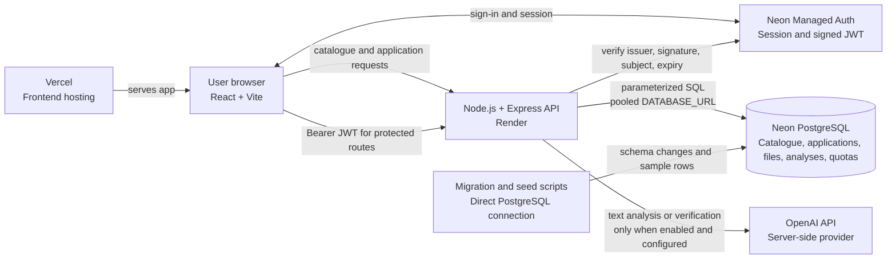

# TSEK architecture

This diagram reflects the implementation currently deployed from `main`:
authenticated application CRUD, private file storage, document analysis, and
an optional text verification endpoint. The `AI_VERIFY_ENABLED` switch is off
by default; see the environment-variable table in the root README and the
[CI/CD setup](CI_CD.md) for configuration and release flow.

## Responsibilities and data flow

- **React frontend:** reads the public document catalogue and manages a signed-
  in user's applications, file uploads, analysis results, and requirement
  checklist. It sends the Neon Auth JWT to protected API routes. Replacing a
  file creates a new file identity and the UI analyzes that replacement.
- **Neon Managed Auth:** issues sessions and JWTs. The backend verifies the
  issuer and signature against the JWKS for the configured Auth branch, then
  uses the token subject as the application owner.
- **Express API:** exposes catalogue, application, file, analysis, validation,
  and health routes. It scopes application data by the verified owner ID.
- **Neon PostgreSQL:** stores catalogue rows, application metadata, uploaded
  file bytes (up to 2 MiB per file), analysis records, and shared AI request
  budget counters. File replacement runs transactionally, removing the old
  file and its analyses before inserting the replacement; a failed insert
  restores the original. Files are stored in PostgreSQL, not object storage.
- **OpenAI:** called only from the backend. The `AI_VERIFY_ENABLED=true`
  setting enables `/api/verify`; document extraction also needs that switch
  and `OPENAI_API_KEY`. Document analysis currently extracts text files only.
- **Vercel and Render:** host the frontend and API. Pull requests use previews;
  the documented release pipeline deploys staging and then production.

Database migrations run separately from API startup. Use a direct Neon
connection for migrations and seeding, and a pooled connection for API traffic.
The current `main` migration set is `001` through `005`. PR #172 proposes
`006_file_revisions.sql`; those revision columns are not included in this
diagram until that PR is reconciled and merged.

