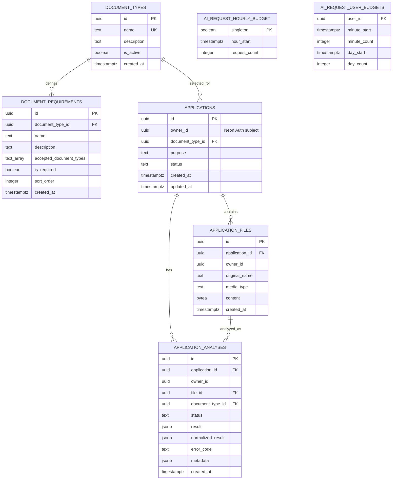

# TSEK database schema

This diagram matches migrations `001_catalogue.sql` through
`005_ai_request_budget.sql` on `main`. The file-revision fields proposed in
PR #172's migration 006 are intentionally not shown.

## Relationships, constraints, and indexes

- Document type names are unique and cannot be blank. Requirements are unique
  by `(document_type_id, name)` and cascade when their type is deleted.
- Applications reference a document type with `ON DELETE RESTRICT`. The
  `owner_id` is the verified Neon Auth user UUID; there is no local users table
  or foreign key into the external Auth system.
- Files reference an application and its owner together, so a file cannot be
  attached to another owner's application. The original name is 1–128
  characters; content is 1 byte to 2 MiB; media types are plain text, PDF,
  JPEG, or PNG. Each application may have at most 10 files in the API.
- Analysis records reference the owning application, uploaded file, and
  selected document type. A completed record must include raw and normalized
  JSON results; a failed record stores an error code and no result.
- AI budget storage has one shared hourly counter and per-user minute/day
  counters. The API enforces 60 requests per UTC hour across users, 3 per user
  per UTC minute, and 20 per user per UTC day.
- `document_requirements_type_order_idx` orders requirements;
  `applications_owner_updated_idx` serves owner-scoped application lists;
  `application_files_application_idx` serves owner-scoped file lists; and
  `application_analyses_latest_idx` serves recent analyses by application and
  file.

`backend/db/seed.sql` contains demonstration service requirements, not
authoritative rules. Confirm requirements with the issuing barangay. The
schema stores uploaded file bytes in PostgreSQL and does not use object
storage.

