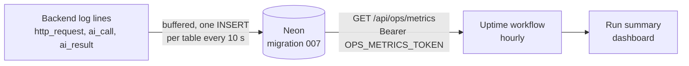

# Signals dashboard

A dashboard is a screen of metrics you check at a glance. Google's SRE team
found that four numbers, the **golden signals**, catch most problems in any
web service. AI features need four more, because a model can be up and fast
and still give bad or expensive answers (end-term deck, Module 7).

The hourly [uptime check](../.github/workflows/uptime.yml) shows all eight for
production, over the last 24 hours, at the bottom of each run's summary
(**Actions → Uptime monitor → latest run**).

| Golden signal | What TSEK measures |
|---|---|
| **Latency** | p95 request duration (p50 in the JSON) |
| **Traffic** | Requests per hour |
| **Error rate** | Share of requests that answered 5xx or never answered |
| **Saturation** | The higher of: database pool connections in use, and this hour's shared AI budget used (60 calls) |

| AI signal | What TSEK measures |
|---|---|
| **Cost per analysis** | Average `costUsd` of a document analysis; the total includes `/api/verify` |
| **Invalid output** | Share of model replies that failed validation (`validation: failed`) |
| **Fallback rate** | Share of analyses where the user got an error instead of a result |
| **Evidence hit rate** | Share of values the model returned that were found word for word in the document. TSEK's version of the slide's "retrieval hit rate": it has no vector search, so this measures whether the answer came from the document |

Under the table, the slowest request of the window is drawn as a waterfall
from its trace, so it shows which step made the user wait.

Health checks, `OPTIONS` requests and the dashboard route itself are not
counted as traffic, so the hourly ping does not hide real users.

## How it works



1. `backend/src/telemetry.js` copies the structured log lines described in
   [`OBSERVABILITY.md`](OBSERVABILITY.md) and
   [`AI_PROVIDER.md`](AI_PROVIDER.md#request-and-cost-controls) into three
   tables: `request_metrics`, `ai_call_metrics`, `ai_result_metrics`. Writes
   are batched off the request path. Rows hold timings, counts and codes
   only, never document text, SQL or user IDs, and are deleted after 14 days.
2. `GET /api/ops/metrics?hours=24` (`backend/src/metrics.js`) computes the
   eight signals. It uses its own token, not a user sign-in, and answers
   `404` when no token is set, so the route is invisible.
3. The uptime workflow calls it with the `OPS_METRICS_TOKEN` secret and
   renders the result with `.github/scripts/metrics-dashboard.mjs`.

Render's free tier keeps no metrics and its logs are not queryable, which is
why the numbers are kept in Neon.

## Setting it up

1. Apply migration `007_telemetry.sql` to the staging and production
   databases ([`RUNBOOK.md`](RUNBOOK.md#database-migrations)).
2. Generate a token: `openssl rand -hex 32`.
3. Set it as `OPS_METRICS_TOKEN` on the production Render service
   (`tsek-api`) and as the repository secret `OPS_METRICS_TOKEN` in GitHub.
   Staging can use a different token for manual checks.
4. Run **Uptime monitor** by hand and open its summary.

Until all three are done, the dashboard step shows a notice and the uptime
check still passes or fails only on uptime.

| Notice | Meaning |
|---|---|
| Not configured | The GitHub secret is not set |
| HTTP 404 | The token is not set on Render, or the backend is older than #278 |
| HTTP 401 | The two tokens differ |
| HTTP 503 | Migration `007` is not applied |

Fields show `—` until there is data. Cost, validation and evidence need the
`ai_result` log line (#275); latency, traffic, errors and the waterfall need
the `http_request` log line (#276).

## Reading it by hand

```bash
curl -s -H "Authorization: Bearer $OPS_METRICS_TOKEN" \
  "https://tsek-fl10.onrender.com/api/ops/metrics?hours=24" | jq .data
```

`hours` is 1 to 168. The JSON also has p50 latency, AI p95 latency, the
repaired-output rate and the saturation parts.
