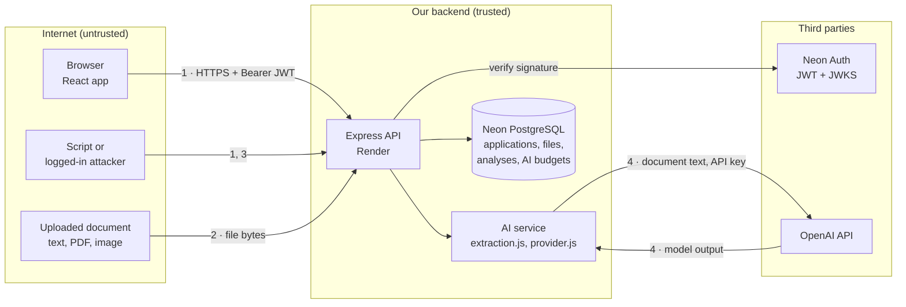

# TSEK threat model

A threat model is a short list of what could go wrong, who could cause it, and
where. A **trust boundary** is any line where data moves from a place we do not
control into one we do. Attacks cluster on those lines, so this page draws them
first and then lists the threats on each one (end-term deck, Module 7,
"threat modeling in 20 minutes").

Review this page when a route, a data store, a third-party service or the AI
prompt changes. Last reviewed: 18 Nov 2026, against `main` @ `24f43ab`.

## Data flow and trust boundaries

| # | Boundary | What crosses it |
|---|---|---|
| 1 | Browser → API | Every request, its JWT, body and route parameters |
| 2 | Uploaded file → database → prompt | Document bytes written by the user, later read into the model prompt |
| 3 | API → AI service | Requests that cost money each time they run |
| 4 | Backend ↔ OpenAI | Document text and our API key going out; untrusted model output coming back |

## Threats and controls

IDs refer to the OWASP Top 10 (2021, `A0x`) and the OWASP Top 10 for LLM
Applications (2025, `LLM0x`).

### 1 · Browser → API

| Threat | OWASP | Control | Where |
|---|---|---|---|
| User A changes an ID in the URL and reads user B's application or file | A01 | Every query filters by the verified token subject (`owner_id = $1`). A record that is not yours returns `404`, so its existence is not revealed | `applications.js`, `application-files.js`, `application-analysis-routes.js` (`scope`) |
| Forged or expired token | A07 | Signature, issuer, subject and expiry checked against the Neon Auth JWKS. A JWKS outage returns `503`, never a pass | `auth.js` |
| Citizen calls staff routes | A01 | `/api/admin/*` checks the role table on every request; client claims and `#/admin` grant nothing | `staff-routes.js`, `docs/staff-dashboard.md` |
| SQL injection through a body or parameter | A03 | Parameterized SQL only; UUIDs and pagination are validated before any query | all repositories, `app.js` |
| Oversized or malformed bodies | A04 | Per-route JSON limits (`4kb` to `1mb`), `413 REQUEST_TOO_LARGE`, `400 INVALID_JSON`, 10,000-character text cap | `app.js` |
| Another website calls the API with a user's browser | A05 | CORS allows only the configured `FRONTEND_URL`; auth is a Bearer header, not a cookie | `app.js`, `config.js` |
| Error bodies leak stack traces or data | A05 | Generic `500` with a request ID; logs carry error names and codes, not messages | `app.js` error handler |

### 2 · Uploaded document → database → prompt

| Threat | OWASP | Control | Where |
|---|---|---|---|
| A document hides instructions for the model ("ignore your rules…") | LLM01 | Instructions say document text is data; lines addressed to the model are stripped before the call; the model has no tools to call | `extraction-prompt.v1.js`, `extraction.js` (`documentEvidence`) |
| The model is fooled anyway and invents values | LLM01, LLM09 | Strict JSON schema, then every value must appear word for word in the document or it is replaced with `null`; staff make the decision, AI results are advisory | `extraction.js` (`keepSupportedValues`), `analysis.js` |
| A file is not what its type says | A04 | Type and size checked on the frontend; the backend checks magic bytes and a 2 MiB / 10-file limit | `app.js` (`matchesFileType`) |
| Model output shown as HTML runs a script in another user's browser (XSS) | LLM05 | React escapes all text; the frontend has no `innerHTML` or `dangerouslySetInnerHTML` | `frontend/src` |
| Downloaded files run in the browser | A03 | Files are sent as `Content-Disposition: attachment` with a sanitized name, `Cache-Control: private, no-store` | `app.js` |

### 3 · API → AI service (cost)

| Threat | OWASP | Control | Where |
|---|---|---|---|
| A script loops the AI endpoint and runs up the bill | LLM10 | Five gates, cheapest first: input size (`413`, 10,000 chars) → rate limit per user (3/min, `429` + `Retry-After`) → daily quota per user (20/day) → `max_tokens` 1000 per call, at most 2 attempts → monthly spend cap on each OpenAI project | `app.js`, `ai-request-budget.js`, `provider.js`, `docs/MAINTENANCE.md` §6 |
| Many users together exhaust the budget | LLM10 | Shared cap of 60 AI calls per hour across all users; budget store failure returns `503` and skips the provider | `ai-request-budget.js` |
| AI turned on where it should not be | LLM10 | `AI_VERIFY_ENABLED` is off by default and acts as a kill switch | `config.js`, `.env.example` |

### 4 · Backend ↔ OpenAI

| Threat | OWASP | Control | Where |
|---|---|---|---|
| API key leaks through the repo or frontend | LLM02, A02 | Keys live only in Render/GitHub settings, one per environment; full-history Gitleaks scan; the bundle audit fails the build if the frontend contains `api.openai.com` or a server secret name | `security.yml`, `bundle-audit.yml` |
| Secrets end up in the prompt and leak through the model | LLM07 | The prompt holds no keys, URLs or internal rules worth hiding; it is versioned in the repo | `extraction-prompt.v1.js` |
| Personal data in documents is sent to a third party | LLM02 | Only extracted text of one file is sent, never IDs or tokens; logs keep token counts and codes, never document text | `extraction.js`, `provider.js` |
| Provider is slow or down and takes the app with it | — | 10 s timeout, one retry with jitter on `429`/`5xx`; AI failures return a clean `502`/`504` and every non-AI route keeps working | `provider.js`, `docs/AI_FAILURE_DRILL.md` |
| A dependency or model changes under us | LLM03 | Lockfiles, `npm audit` in CI, Dependabot; model changes go through the eval set first | `security.yml`, `docs/MAINTENANCE.md` |

### Not applicable

- **LLM04 Data and model poisoning:** we do not train or fine-tune a model in
  production. Revisit this if the fine-tuned model is deployed.
- **LLM06 Excessive agency:** the model has no tools, cannot write to the
  database and cannot send anything; the backend decides what to store.
- **LLM08 Vector and embedding weaknesses:** TSEK has no vector store or RAG.

## Known gaps

| Gap | Risk | Tracked in |
|---|---|---|
| Document text is sent as a bare message, not inside delimiter tags | LLM01, weaker boundary between data and instructions | #279 |
| No circuit breaker or bulkhead on the provider | A provider outage holds every AI request for the full timeout and still charges the user's quota; nothing limits AI calls in flight | #277 |
| AI call log has no cost, retry count or validation result | Cost per analysis and invalid-output rate cannot be shown | #275 |
| No per-request log or trace | A slow or failed request cannot be explained after the fact | #276 |
| No dashboard for latency, errors or AI cost | Abuse or regressions are found late | #278 |
| No antivirus scan of uploaded PDFs and images | Files are stored and returned as attachments only, never opened by the backend | Accepted for this release |
